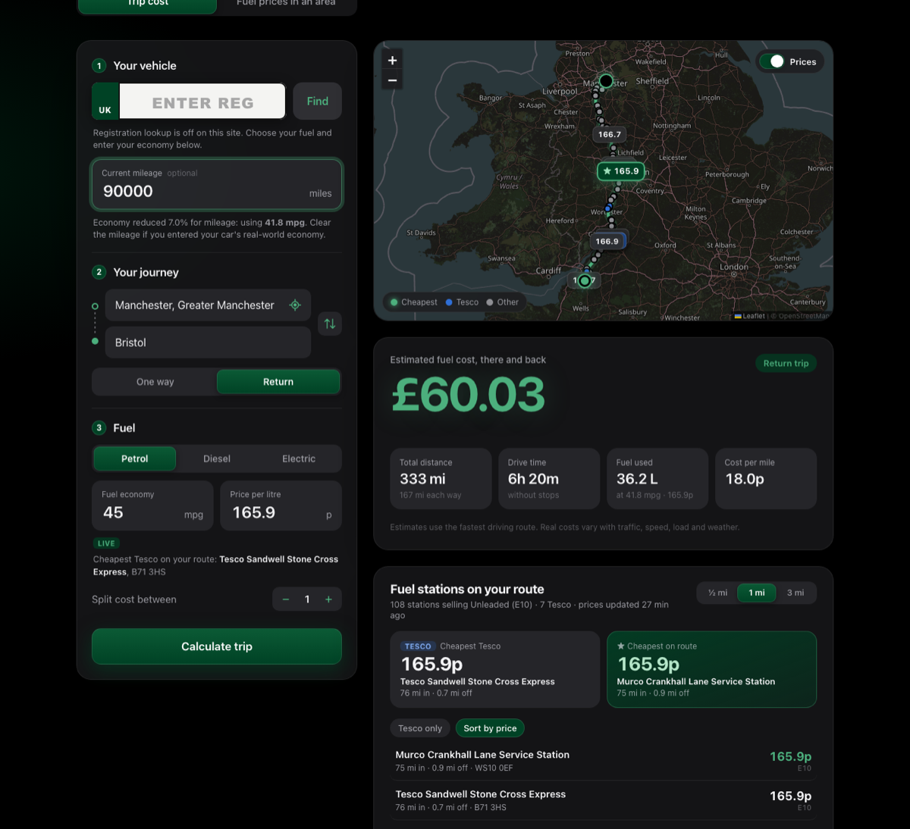
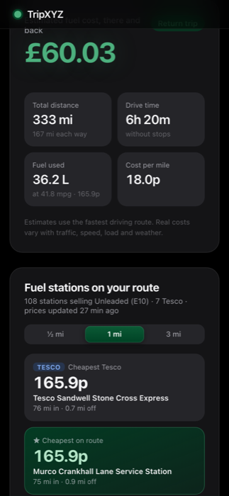

# TripXYZ

> I simply got bored of looking for fuel on journeys, and found it easy enough to build this.

TripXYZ works out how far a UK car journey is and what the fuel will cost, using live pump prices from stations along the way. It can also show the cheapest fuel around any town, postcode or your current location.

**Live site:** https://isheanesumazwi.github.io/TripXYZ/



## Features

- **Trip cost.** Pick a start and destination, one way or return. TripXYZ shows the total distance in miles, the drive time, the fuel used and the cost. It can also split the cost between passengers.
- **Multiple stops.** Tap **+ Add stop** to plan A → B → C and beyond, up to 10 stops. Stops can be moved up or removed, and each leg's distance and time is listed. A return trip drives back from the last stop to the start.
- **Live prices on the route.** Every station within your chosen detour of the route is shown on the map. The price per litre defaults to the cheapest Tesco on the route, or the cheapest station if there's no Tesco. You can pick any station and use its price instead.
- **Fuel prices in an area.** Search a place or use your location, choose a radius, and see every nearby station sorted by price.
- **Station details and directions.** Tap any station for its address, postcode and every fuel price, then open driving directions in Apple Maps or Google Maps.
- **Prices switch.** Hide all station markers to see just the route, and show them again with one tap.
- **Registration lookup.** Enter a UK number plate to get the make, model, fuel type and engine size, plus an estimated MPG.
- **Mileage adjustment.** Older engines use a little more fuel, so the economy figure is reduced for high mileage. A registration lookup fills this in from the car's MOT history.
- **Works on a phone.** The layout is built mobile-first and the price toggle keeps the map readable.



## How it works

| Part | Source |
|---|---|
| Place search | [Photon](https://photon.komoot.io), built on OpenStreetMap |
| Driving route, distance and time | [OSRM](https://project-osrm.org) public routing server |
| Map | OpenStreetMap tiles with Leaflet |
| Vehicle lookup API | [Netlify Functions](https://docs.netlify.com/build/functions/overview/) |
| Live fuel prices | [UK Government Fuel Finder](https://www.gov.uk/guidance/access-the-latest-fuel-prices-and-forecourt-data-via-api-or-email) open data |
| Vehicle details and mileage | [DVSA MOT History API](https://documentation.history.mot.api.gov.uk) |
| CO₂ figure, optional | [DVLA Vehicle Enquiry Service](https://developer-portal.driver-vehicle-licensing.api.gov.uk) |

The website is a static page, so it runs free on GitHub Pages. Everything that needs a secret key happens out of sight of the browser:

1. A scheduled GitHub Action runs every hour. It downloads every UK forecourt price from Fuel Finder using encrypted repository secrets, and publishes the result with the site as `data/stations.json`.
2. In the browser, TripXYZ plans the route, then finds the stations within a few miles of it using a simple spatial grid.
3. The route goes through every stop in order, and a return trip adds the drive home from the last stop.
4. The cost is `total miles ÷ mpg × 4.546 litres per gallon × price per litre`. Petrol is priced as E10 unleaded and diesel as B7.
5. Registration lookup needs the MOT History API key, so the browser asks a small Netlify function instead. The function holds the key as a secret setting, only answers requests from the TripXYZ site, and is rate limited. Locally, the Node server does the same job.

### The numbers

- **MPG from a registration** is estimated from the official CO₂ figure when a DVLA key is set, with a 10% real-world correction. Otherwise it is estimated from engine size, fuel type and age.
- **Mileage** has no effect up to 20,000 miles. After that, economy drops about 1% per 10,000 miles, up to 15%. Electric cars get half that. Leave mileage blank if you entered your car's real-world MPG.
- **Detour** is the straight-line distance from a station to the route.

These are estimates. Real fuel use depends on traffic, speed, load and weather.

## Run it locally

You need Node 18 or newer. There are no dependencies to install.

```bash
cp .env.example .env    # add your API keys
npm start               # http://localhost:3000
```

Running locally turns on registration lookup and keeps live prices refreshed every hour.

| Variable | Used for |
|---|---|
| `MOT_API_KEY`, `MOT_CLIENT_ID`, `MOT_CLIENT_SECRET`, `MOT_TOKEN_URL` | Registration lookup |
| `DVLA_API_KEY` | Optional CO₂ figure for a better MPG estimate |
| `FUEL_FINDER_CLIENT_ID`, `FUEL_FINDER_CLIENT_SECRET` | Live fuel prices |

## Deploy to GitHub Pages

1. Go to **Settings → Pages** and set **Source** to **GitHub Actions**.
2. Go to **Settings → Secrets and variables → Actions** and add `FUEL_FINDER_CLIENT_ID` and `FUEL_FINDER_CLIENT_SECRET`.
3. Push to `main`, or run the **Deploy to GitHub Pages** workflow by hand.

The workflow redeploys every hour with fresh prices. If the price download fails, the site keeps the last published prices.

### Vehicle lookup API on Netlify

`netlify/functions/vehicle.mts` serves `/api/vehicle` and `/api/config`. To set it up on your own Netlify account:

1. Create a Netlify project and deploy this repo to it. `netlify.toml` already points at the function.
2. In **Project configuration → Environment variables**, add `MOT_API_KEY`, `MOT_CLIENT_ID`, `MOT_CLIENT_SECRET` and `MOT_TOKEN_URL`. Mark them as secret and include the **Functions** scope. `DVLA_API_KEY` is optional.
3. Set `ALLOWED_ORIGINS` if your site isn't at `https://isheanesumazwi.github.io`.
4. Redeploy so the function picks up the new settings.
5. Change the Netlify address in `public/config.js` if yours is different.

## Keeping keys safe

- API keys live only in `.env`, which git ignores, in GitHub Actions secrets and in Netlify's secret environment variables.
- The public site only ever receives the finished price list, never a key.

## Project structure

```
public/            Static website (deployed to GitHub Pages)
  index.html
  styles.css
  app.js           UI, routing, cost calculation
  geo.js           Station data format and spatial search (shared with Node)
  config.js        Optional address of a hosted API server
  data/            Published fuel prices
server.js          Local server: vehicle lookup and live price cache
lib/vehicle.js     Vehicle lookup shared by the local server and Netlify
netlify/           Netlify function for the hosted vehicle lookup API
fuel.js            Fuel Finder download and normalisation
scripts/           Price download used by the GitHub Action
```

## Credits

Map data © OpenStreetMap contributors. Routing by OSRM. Place search by Photon. Fuel prices from the UK Government Fuel Finder scheme. Vehicle data from the DVSA and DVLA.

## Licence

[MIT](LICENSE)
